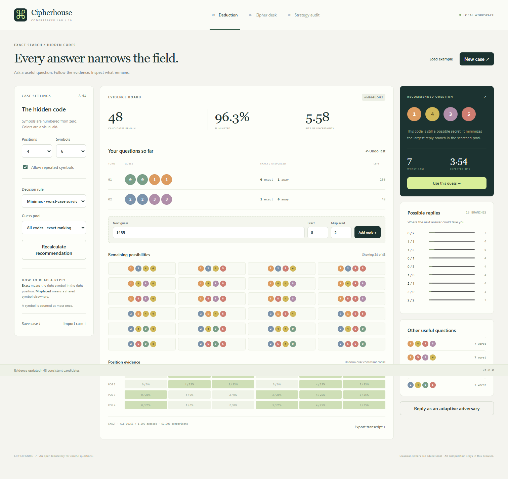

# Codebreaker Lab · Cipherhouse

An inspectable laboratory for exact code deduction and classical cryptanalysis. Play with hidden-code evidence, compare information-based strategies, investigate cipher structure, and export experiments you can reproduce.



## Run locally

Requires **Node.js 24 or newer**. Runtime computation uses no third-party packages.

```sh
npm ci --ignore-scripts
npm start
```

Open **http://127.0.0.1:4179/**. The server binds to loopback. The browser runs searches in a cancellable module worker; messages and sessions stay on your device. To use another port, set the `PORT` environment variable. Opening the HTML as a file will not run module workers correctly.

## Three workspaces

- **Deduction:** repeated or unique-symbol games, exact candidate filtering, minimax / Shannon entropy / expected survivors, restricted or seeded guess pools, posterior position heatmaps, alternatives, feedback branches, adaptive adversary replies, contradiction explanations, undo, JSON session imports, and CSV transcripts.
- **Cipher desk:** twelve classical modes, original challenges, frequency / coincidence / entropy evidence, Kasiski repeats, weighted period scans, exhaustive Caesar and affine searches, Vigenère column beams, crib-constrained substitution annealing, and transposition enumeration.
- **Strategy audit:** a complete standard-game minimax tree covering every one of 1,296 secrets, plus paired seeded strategy comparisons and JSON report downloads.

The library also exposes caller-supplied word-dictionary deduction, bijective word-pattern matching, side constraints, and branch lookahead. These are library APIs rather than additional UI workspaces.

## Library example

```js
import { createScorer, replay, rankGuesses, vigenere } from './src/index.js';
const scorer = createScorer(); // four positions, six symbols, repeats enabled
const state = replay(scorer, [{ guess: [0, 0, 1, 1], response: { exact: 0, misplaced: 1 } }]);
const ranking = rankGuesses(scorer, state.ids, { strategy: 'minimax' });
console.log(ranking.rows[0], ranking.exactGlobal);
console.log(vigenere('LXFOPV EF RNHR', 'LEMON', true));
```

Install the release TGZ with `npm install ./victorodoyo-codebreaker-lab-1.0.0.tgz` and import from `@victorodoyo/codebreaker-lab`. The TGZ is an installable release asset, not a claim of npm registry publication. Use the source ZIP or Git checkout for tests and independent validation.

## Verification

```sh
npm test
npm run benchmark
python validation/reference_oracles.py
npx playwright install chromium
npm run test:browser
npm run package:check
npm run format:check
```

Python 3.10+ is sufficient; reference checks use only its standard library. Set `BROWSER_EXECUTABLE` to a Chromium-family executable for an existing local browser, or install Playwright Chromium. CI tests Windows and Linux, Chromium, package installation, formatting, benchmarks, and independent oracles.

Current checks include **65 Node tests**, **35 browser checks**, **8,971 independent oracle cases**, an exhaustive **1,296-secret** audit, **90 paired runs**, and **17 controlled cipher recoveries**. See [validation](docs/validation.md) for what these checks establish and what they do not.

## Reading the claims

Exact candidate filtering follows the transcript; it does not verify the honesty of a human reply. An exact ranking covers the stated guess pool and one-step objective, not a globally optimal decision tree. Language rankings and annealing are heuristic. A complete key enumeration establishes coverage, not that the highest language score must be the intended message. Classical ciphers here are educational.

[Algorithms](docs/algorithms.md) · [Cipher conventions](docs/ciphers.md) · [API guide](docs/api.md) · [Session format](docs/sessions.md) · [Architecture](docs/architecture.md) · [Limits](docs/limits.md)

MIT licensed. Corpus and challenge prose were authored for this repository; no external word list or language dataset is bundled.
